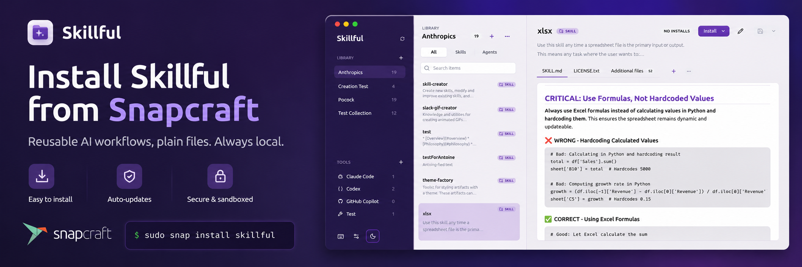

A few weeks ago I started building Skillful because reusing my AI workflows had become more work than it should have been. I had prompts in ChatGPT and Cursor, notes in Obsidian, and markdown files scattered across repositories. The screenshots and helper scripts that went with them were often somewhere else entirely.

Getting a workflow into another tool usually meant copying it, finding the supporting files and putting everything back together. After a few rounds of that, I had several slightly different versions and no easy way to tell which one contained my latest changes.

I wanted a place to manage those workflows and make them available to the tools I already used. That became Skillful.

## Keeping a workflow together

In Skillful, each skill or agent is a folder on disk. It holds the instructions along with whatever makes them useful: notes, examples, screenshots, scripts or metadata. Keeping those pieces together means I can work on the whole workflow without hunting through old conversations or unrelated repositories.

Skillful manages the links between that folder and the tools where I want to use it. The folder remains the source, so an improvement to the instructions is available wherever I've linked the skill.

This also keeps the library independent of the app. I can edit the files in my usual editor, version them with Git and share them with someone else. If I stop using Skillful, the work I've put into those files is still available to me.

## How I use it

For an API review workflow, I might start with a folder like this:

```txt
skills/
  api-review/
    SKILL.md
    notes.md
    examples/
    scripts/
```

`SKILL.md` contains the instructions I want the AI to follow. I use `notes.md` for context and edge cases I've encountered, then add sample inputs, expected outputs or helper scripts as I need them.

Once the skill is ready, I use Skillful to install it into the tools I work with, such as Codex or Claude. That installation links back to the source folder. When a review reveals something the instructions missed, I update the original and use the revised version next time, whichever linked tool I'm working in.

If an installation breaks, I can repair it in Skillful or remove the link and install it again. The source files stay in place throughout.

Over time, this has changed how I approach prompts. I spend more time refining workflows I've already used and less time reconstructing them from memory. Keeping them in Git also lets me review changes and share a workflow together with the examples and context behind it.

## A local library alongside my tools

I still use editors, chat tools and notes for their own purposes. Skillful handles the practical work of keeping reusable workflows organised and available across those environments.

The library stays on my machine, with no cloud dependency, hidden sync or background services. I can manage it offline and choose how to back it up or share it. That suits the way I already work with code and documentation, and it keeps the setup straightforward.

That's the problem I wanted Skillful to solve: making the workflows I put time into easier to use again. If you've found yourself maintaining the same prompt in several places, you can take a look at [Skillful](https://skillful.md).


